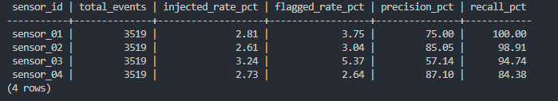
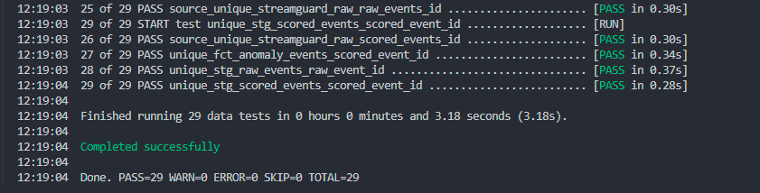
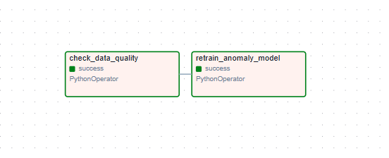
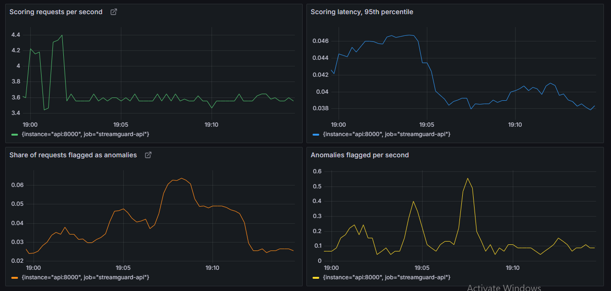
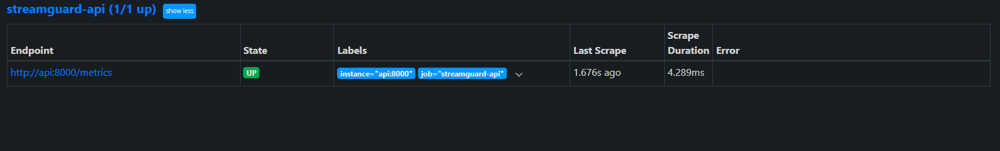
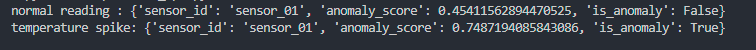

# StreamGuard — Real-Time IoT Anomaly Detection & Analytics Platform

End-to-end data platform that ingests streaming IoT sensor telemetry, scores it for anomalies in real time, orchestrates periodic retraining and data-quality checks, models the results into analytics-ready tables, serves scores over a REST API, and monitors the running system in Prometheus and Grafana.

This is a production-shaped extension of self-supervised anomaly detection research on streaming IoT data, originally explored in an M.Sc. thesis at Fraunhofer ISST, rebuilt here around a modern data engineering stack.

---

## Measured results

Detection quality is computed inside dbt by joining the model's predictions to ground-truth labels that the model never sees. The figures below come from one full hour of streaming across four simulated sensors.

| Sensor | Events | Injected | Flagged | Precision | Recall |
|---|---|---|---|---|---|
| sensor_01 | 3,519 | 2.81% | 3.75% | 75.00% | 100.00% |
| sensor_02 | 3,519 | 2.61% | 3.04% | 85.05% | 98.91% |
| sensor_03 | 3,519 | 3.24% | 5.37% | 57.14% | 94.74% |
| sensor_04 | 3,519 | 2.73% | 2.64% | 87.10% | 84.38% |

**Combined over 14,076 events:** 401 injected anomalies, 521 flagged, 379 true positives, 142 false positives, 22 false negatives.

**Precision 72.7%, recall 94.5%, F1 0.82.**

The API sustains roughly 3.6 requests per second in local testing with a 95th-percentile scoring latency of about 40 ms.



Two things are worth stating plainly. The anomalies are injected by the included simulator, so these are results on synthetic data under controlled conditions rather than on real production sensors. And the model is fully unsupervised. The `is_synthetic_anomaly` label exists only so quality can be scored after the fact, and it is never passed to the model at training or inference time.

---

## Architecture

```
IoT sensors (simulated)
        │  JSON events
        ▼
   Kafka / Redpanda  ──topic: iot.telemetry──┐
        │                                     │
        ▼                                     │
  Stream Consumer                             │
  (rolling features + IsolationForest)        │
        │                                     │
        ▼                                     │
   PostgreSQL  ◄── raw_events / scored_events │
        │                                     │
        ▼                                     │
   dbt (staging → marts)                      │
   fct_anomaly_events                         │
   agg_hourly_anomaly_rate                    │
        │                                     │
        ▼                                     │
   Apache Airflow                             │
   hourly: data-quality checks + retrain      │
                                              │
   FastAPI  ◄── on-demand /score endpoint ────┘
        │
        ▼
   Prometheus  ──scrapes /metrics──►  Grafana dashboard
```

## Stack

| Layer | Tool |
|---|---|
| Ingestion | Kafka-API compatible broker (Redpanda) |
| Stream processing | Python (kafka-python, scikit-learn IsolationForest) |
| Storage | PostgreSQL 16 |
| Transformation | dbt-core |
| Orchestration | Apache Airflow |
| Serving | FastAPI |
| Metrics collection | Prometheus |
| Dashboards | Grafana |
| Testing | pytest, ruff, dbt tests |
| CI | GitHub Actions |
| Infrastructure as code | Terraform (Azure), Kubernetes manifests |

---

## How detection quality is measured

`raw_events` stores the ground-truth flag. `scored_events` stores the model's prediction. The dbt mart `fct_anomaly_events` joins them and labels every event as one of four outcomes.

```sql
case
    when s.is_anomaly and r.is_synthetic_anomaly     then 'true_positive'
    when s.is_anomaly and not r.is_synthetic_anomaly then 'false_positive'
    when not s.is_anomaly and r.is_synthetic_anomaly then 'false_negative'
    else 'true_negative'
end as detection_outcome
```

`agg_hourly_anomaly_rate` then rolls those outcomes up per sensor per hour and derives precision and recall directly in SQL. This mirrors how an anomaly-detection system is monitored in production, where model quality is a data product rather than a number from a training notebook.

---

## Data quality and testing

29 dbt tests run across sources, staging models and marts, covering uniqueness, null checks, accepted values and source freshness.



The Airflow DAG runs hourly. It first checks freshness and nulls in `raw_events`, and refuses to retrain if no data arrived in the last hour or if any sensor readings are null. Only if those checks pass does it retrain the IsolationForest on the most recent 5,000 events.



Unit tests and linting run on every push through GitHub Actions, followed by a Docker image build for the API.

---

## Monitoring

The API exposes Prometheus-format metrics at `/metrics`. Prometheus scrapes them every 15 seconds and Grafana renders four panels: request rate, anomalies flagged per second, 95th-percentile scoring latency, and the share of requests flagged as anomalies.



That last panel is the useful one. It should track the real anomaly rate in the incoming traffic, so a sustained drift away from it is a signal that either the data or the model has changed. During development this panel caught an input distribution mismatch that every unit test and dbt test had passed over, which is a reasonable argument for having it at all.



The Grafana datasource is provisioned automatically from `grafana/provisioning/`, and the dashboard definition is version-controlled in `grafana/dashboards/streamguard.json`, so a fresh clone comes up with working dashboards rather than an empty Grafana.

---

## Prerequisites

- Docker Desktop
- Python 3.11+ for running the producer, consumer and scripts outside containers

## Quickstart

```bash
git clone https://github.com/kenil0savani/streamguard.git
cd streamguard
cp .env.example .env
```

Open `.env` and set `MODEL_PATH` to an absolute path pointing at `models/isolation_forest.joblib` in your clone.

```bash
# 1. Start the stack
docker compose up -d redpanda postgres airflow api prometheus grafana

# 2. Install local Python dependencies
python -m venv .venv && source .venv/bin/activate   # Windows: .venv\Scripts\activate
pip install -r requirements.txt

# 3. Start the IoT data simulator (terminal 1)
python data_simulator/producer.py

# 4. Start the stream consumer (terminal 2)
cd stream_processor && python consumer.py

# 5. After a few minutes, build the analytics models
docker compose run --rm dbt run
docker compose run --rm dbt test
```

Services come up at:

| Service | URL | Credentials |
|---|---|---|
| FastAPI | http://localhost:8000 | — |
| Airflow | http://localhost:8080 | admin / admin |
| Prometheus | http://localhost:9090 | — |
| Grafana | http://localhost:3000 | admin / admin |

## Try the scoring API

```bash
python scripts/demo_api.py
```



Or call it directly.

```bash
curl -X POST http://localhost:8000/score \
  -H "Content-Type: application/json" \
  -d '{"sensor_id": "sensor_01", "temperature": 95.4, "vibration": 3.2}'
```

To generate continuous traffic for the Grafana dashboard:

```bash
python scripts/load_api.py
```

## Inspect the results

```bash
docker compose exec postgres psql -U streamguard -d streamguard \
  -c "select * from analytics.agg_hourly_anomaly_rate order by event_hour desc limit 10;"
```

Note that `agg_hourly_anomaly_rate` is materialised as a table, so run `dbt run` before querying it to pick up newly streamed events.

---

## Known limitations

These are real and worth stating rather than hiding.

**API cold start.** The `/score` endpoint maintains its own rolling feature window, which starts empty when the container boots. Until roughly 30 readings have arrived for a given sensor, the rolling statistics do not resemble the training distribution and the endpoint over-flags. `scripts/demo_api.py` warms the window before testing. The proper fix is to seed the window from recent history in PostgreSQL on startup.

**Fixed contamination.** The IsolationForest is configured with `contamination=0.03`, so it flags close to 3% of events regardless of the true rate. Where a sensor's real anomaly rate is lower, the surplus alarms become false positives. This is visible in the results above, where sensor_03 flags 5.37% against an injected 2.85% and its precision drops accordingly.

**No feature scaling.** The eight features span very different ranges, from temperature around 70 down to z-scores around 0. IsolationForest splits on raw values, so the larger-scale features carry more weight than they should. Adding a scaler would make all features contribute evenly and would also make the cold-start bootstrap behave sensibly.

**Health endpoint.** `/health` reports that the service is up but does not report whether the model loaded successfully.

**Synthetic data.** Injected faults are clean and distinct. Real sensor degradation is gradual, noisy and mixed with missing values, so performance on a real dataset should be expected to be lower.

---

## Repository layout

```
data_simulator/     synthetic IoT sensor event generator → Kafka
stream_processor/   feature engineering + anomaly model + Kafka consumer
airflow/dags/       hourly data-quality + retraining DAG
dbt_project/        staging and marts models, schema tests
api/                FastAPI real-time scoring service
prometheus/         Prometheus scrape configuration
grafana/            provisioned datasource and dashboard definition
scripts/            demo and load-generation helpers
sql/                PostgreSQL schema
infra/              Terraform for Azure (see ROADMAP)
k8s/                Kubernetes manifests (see ROADMAP)
tests/              pytest unit tests
docs/               screenshots used in this README
.github/workflows/  CI: lint, test, build
```

See `ROADMAP.md` for what is deployed, what is written but not deployed, and what comes next.

## Licence

MIT
